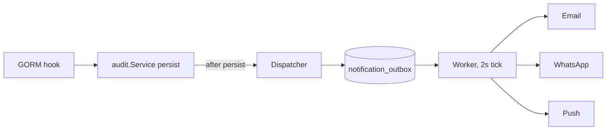

# Example: go-backend #483 (layer 3 of a 5-PR stack, 4.1k lines)

Written from the file list below and the commit messages. Half the diff was tests, a third of the rest was copy; the review order says so and sends the reader to the schema and dispatcher first.

```markdown
Layer 3 of 5 (TICKET-1392). Base: `main`.

**What it does**
- Turns audit log rows into durable notifications: dispatcher → `notification_outbox` → worker → email / WhatsApp / push.
- Customer copy for 7 job and billing events in ru, en, kk. `ru` is sent until users carry a language. The 3 billing sets are dormant: nothing emits them yet.
- The worker is off unless `notifications.worker_enabled` is true, so a deploy alone sends nothing.
- Removes the old inline notifier (`messaging/audit`) and the `log_types` / `role_scopes` plumbing.



**Behaviour to know**
- One row per (event, recipient, channel). A flapping status does not notify twice.
- "Request accepted" (JOB_CREATED) goes only to client-ordered jobs.
- Worker: 3 attempts, 1m / 5m / 30m backoff, skips jobs already in a final status, clears an FCM token only when FCM says `UNREGISTERED`.
- WhatsApp rows fail until the Meta templates exist: `job_created`, `job_assigned`, `job_enroute`, `job_completed`; dormant `contract_expiring`, `overdue_payment`, `invoice_issued`. Param order is documented in `templates/`.

**How to review** (about 2.5k non-test lines, a third of it copy)
1. `migrations/20261016100000_notification_outbox_and_mute.sql`, `models/notification_outbox.go`: the two tables.
2. `notification/events.go`, `entity.go`, `rules.go`, `recipients.go`: audit row → event → who gets it.
3. `notification/dispatcher.go`: writes the outbox rows. Then `repository/notification_outbox_repository.go`.
4. `notification/worker.go`: sends and marks rows. Then `cloud/fcm/client.go` and `base_sender/retrying_sender.go` for the non-retryable path.
5. `audit/service.go`, `messaging/messaging.go`, `platform/scale_platform.go`: wiring and the worker flag.
6. `templates/registry.go`, `format.go`, `job.go`: rendering and the job copy. `billing.go`, `contract.go`, `labels.go` are data, skim.
7. Tests last: `dispatcher_test.go` (a full job run through real GORM hooks), `worker_test.go`, `templates/registry_test.go`.

Deleted files under `messaging/audit/` need no reading.

**Tests.** Events, rules, recipients, entity lookup; every event × language × channel renders; outbox claim / backoff / dedup / mute; dispatcher rule and mute matrix; worker success, retry, max attempts, stale, unregistered token, stop mid-send; audit notify queue never blocks `Log`.

🤖 Generated with [Claude Code](https://claude.com/claude-code)

```
